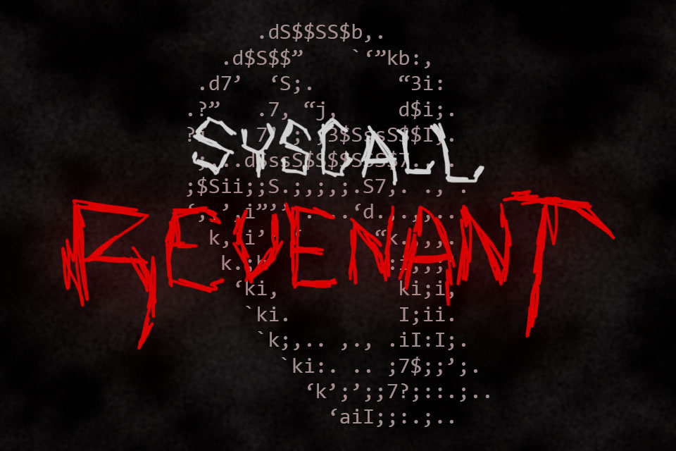
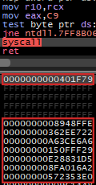
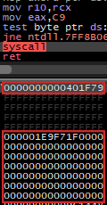

<div align="center" markdown="1">
  
  </br>
  <sup>Surpassing EDRs & AVs</sup>
</div>

# SyscallRevenant

SyscallRevenant is a new method of performing clean indirect syscalls. 
The main component resolves **System Service Numbers** (SSNs) and `syscall` instruction addresses dynamically.
This is done by enabling the trap flag during execution.
The secondary component is **tampering** via parameter replacement before a `syscall`.
This combination is designed to bypass userland hooks during the subsequent syscall invocation while substituting the initially presented parameters.

**Disclaimer**: The purpose of this is for educational purposes and testing only.
Do not use this on machines you do not have permission to use.
Do not use this to leverage and communicate with machines that you do not have authorization to use.

## Preamble.

Indirect syscalls is a method of executing `syscall` instructions in trusted userland space.
If a user finds a `syscall` instruction, they may jump to it indirectly.
An event enabled during a tracing session can reveal the return address immediately after the instruction.

This does not account for **Endpoint Detection & Response** (EDR) userland hooks.
An EDR may insert hooks into `ntdll.dll`, therefore deprecating the lookup process for SSNs and `syscall` instructions.
Entering a hook will benefit the owning thread, not raising a malicious score.
Observing an entry into a function and observing the resulting operation are different things.
RevenantSyscalls investigates that gap.

## How it works.

The following sections outline the project’s two main components.
The first component resolves function addresses from `ntdll.dll` loaded by the process.
A trap walk may then be performed if syscall information is needed.
The second component performs an indirect jump to the saved function information.

Reading from the segment register can retrieve the **Process Environment Block** (PEB).
The `LoaderData` is a field in the PEB that contains data loaded with each process.
`LoaderData` contains information about modules loaded alongside each process.
Module names and base addresses exist in module entries.

A **Dynamically Linked Library** (DLL)’s export information describes the symbols it exports.
Export metadata supports locating exported symbols.
The index of a function applies only to names and name ordinals.
Hashing a function name is the best for low memory environments.

A vectored exception handler is an exception handling mechanism that catches exceptions from anywhere within a process.
Enabling the trap flag causes an `EXCEPTION_SINGLE_STEP` exception on the next instruction executed.
A custom vectored exception handler can inspect the `RIP` and check for a `syscall`.
By repeatedly resetting the trap flag, the `syscall` address will be discovered and SSN saved.

## Example.

<table align="center">
  <tr>
    <td align="center">
      <sup>Syscall Lookup</sup><br>
      
    </td>
    <td align="center">
      <sup>Syscall Execution</sup><br>
      
    </td>
  </tr>
</table>

Each syscall has the initial syscall information lookup;
Hooks will be entered to retrieve syscall information.
Proceeding, an indirect jump will be made to the syscall.
There will be an assoicated **RIP** spoof (from original entry).
With re-entry, the initial parameters have been tampered.

From an **Event Tracing for Windows** (ETW) perspective, the events possibly emitted are: `SysEnter`, `SysExit`, and `StackWalk` for either.
If an EDR builds similar, comparable events, these will look nearly identical.
The only differences will lie in durastically different **Query Performance Counter** (QPC) time stamps.

## Technicals.

###### Follow with `src/AsmRevenant.asm`

```asm
        REAL_RTN: DQ 0
        FAKE_RTN: DQ 0

; If a syscall information lookup is in progress, the
; initial entry return address needs to be preserved.

        MOV     RAX,    QWORD PTR       [RSP]
        MOV     QWORD PTR [FAKE_RTN],   RAX

; Once the re-entry is made, the real return is saved,
; and the current is spoofed with initial return.

        MOV     RAX,    QWORD PTR       [RSP]
        MOV     QWORD PTR [REAL_RTN],   RAX
        MOV     RAX,    QWORD PTR       [FAKE_RTN]
        MOV     QWORD PTR [RSP],        RAX
```

###### Follow with `src/Revenant.c`

```c
LONG VectoredExceptionHandler(EXCEPTION_POINTERS *BreakPoint) {
        ...
        // If a syscall information lookup is being made, the
        // syscall instruction address is saved, the SSN is
        // saved, and the return is rerouted.
        if (LookupInProgress && *(USHORT*)BreakPoint->Address == 0x050F) {
                SyscallInstruction = BreakPoint->Address;
                SyscallSSN = BreakPoint->Context->Rax;
                BreakPoint->Context->Rip = SyscallExit;
        }

        // When re-entered, if the previous instruction was
        // a syscall, reset return address, and exit.
        if (!LookupInProgress && *(USHORT*)(BreakPoint->Address - 2) == 0x050F) {
                *(VOID**)BreakPoint->Context->Rsp = REAL_RTN;
                BreakPoint->Context->Rip = SyscallExit;
        }
        ...
}
```